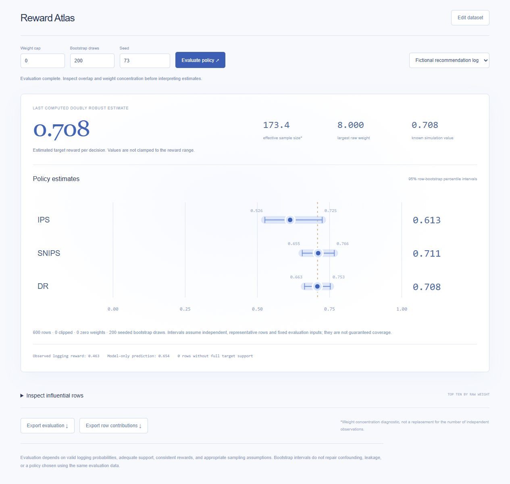

# Reward Atlas

An off-policy evaluation workbench for logged decisions. Compare importance sampling, self-normalized importance sampling, and doubly robust estimates; inspect support, weight concentration, clipping, and reproducible bootstrap intervals.



## Run

```sh
python run.py --port 8000
```

Open http://127.0.0.1:8000. Python 3.10+ serves static assets; the browser performs evaluation in a worker. No runtime packages, credentials, or external AI services are used. Tests require Node 22+.

The default is a fictional 600-decision recommendation log with three actions and three repeating context types. The logging probabilities are `[0.65, 0.25, 0.10]`; each target policy favors its context's preferred action with probability 0.8. Rewards are seeded Bernoulli draws from a known simulation, while the supplied reward predictions deliberately differ from those true probabilities.

Default results: IPS 0.613359, SNIPS 0.710602, DR 0.707735, model-only prediction 0.654333, and observed logging reward 0.463333. The known target value averaged over these simulated contexts is 0.708333. This single example is a reproducibility fixture, not evidence that one estimator always performs better.

The estimate panel pairs numerical summaries with wide interval bands, labeled endpoints, and a separate simulation reference line. Interval reveals respect reduced-motion preferences. Missing support replaces the plot with an explicit explanation; editing the log uses a focused dialog. The narrow-screen chart and influential-row table scroll within their own containers.

## Explore

- Change the weight cap: zero disables clipping. Positive caps reduce extreme contributions but can introduce bias.
- Inspect the three estimates and their seeded 95% row-bootstrap percentile intervals. The dashed line marks the known simulation value when available.
- Expand influential rows to inspect raw/used weights and individual DR contributions. Contributions and IPS/DR estimates can lie outside `[0,1]`; they are not silently clamped.
- Choose the missing-overlap fixture to see policy-value estimates withheld when logging probabilities do not support the target policy.
- Edit the full dataset JSON. Any edit clears the known-simulation label and invalidates exports until recomputation.
- Export the normalized dataset, diagnostics, settings, intervals, and every contribution as JSON; export contributions separately as CSV.

## Dataset

```json
{
  "actions": ["Guide", "Explore"],
  "rows": [
    {
      "action": 0,
      "reward": 1,
      "behavior": [0.75, 0.25],
      "target": [0.5, 0.5],
      "q": [0.65, 0.8]
    }
  ]
}
```

Action indexes start at zero. Behavior and target vectors are complete distributions for that row's context; `q` contains fixed predicted expected rewards for each action. The app does not train a reward model or infer propensities. Predictions should be supplied independently of the evaluated reward, for example from held-out training or an appropriate cross-fitting procedure. Context features themselves are not required by the arithmetic and are not modeled by this app.

Limits: 2–5 unique action names, 1–2,000 rows, two million editor characters, 50–1,000 bootstrap replicates, and a nonzero 32-bit seed. Action names contain 1–24 ASCII letters/digits/underscores/hyphens and begin with a letter or digit. Rewards and q values must be finite numbers in `[0,1]`. Probability sums must be within 10^-9 of one and are normalized; positive logging probabilities must be at least 10^-6. A recorded action cannot have zero logging probability. Additional row metadata is discarded during normalization.

The complete default dataset is [docs/example.json](docs/example.json). The missing-support example removes observations of the third action and sets its behavior probability to zero; it is an intentionally invalid-support demonstration, not an alternative valid log from the original simulation.

## Estimators

For row i, let `w = target(action) / behavior(action)`, `r` be its reward, and `qTarget = sum(target(a) * q(a))`.

| Estimate                | Formula                               |
| ----------------------- | ------------------------------------- |
| IPS                     | `mean(w * r)`                         |
| SNIPS                   | `sum(w * r) / sum(w)`                 |
| DR                      | `mean(qTarget + w * (r - q(chosen)))` |
| Model only              | `mean(qTarget)`                       |
| Observed logging reward | `mean(r)`                             |

With a positive cap c, `min(w,c)` replaces w in IPS, SNIPS, and the DR correction. All three are labeled clipped. The model-only baseline remains unchanged. Effective sample size is `(sum(w))² / sum(w²)`; both raw and used-weight versions are exported. It describes weight concentration, not the amount of independent information in correlated observations.

The doubly robust approach combines a reward model with a propensity-weighted correction, as developed in [Dudík, Langford, and Li, “Doubly Robust Policy Evaluation and Learning”](https://arxiv.org/abs/1103.4601). Its theoretical properties depend on the data-generating assumptions and nuisance estimates; clipping changes those properties. This app exposes the arithmetic and diagnostics rather than certifying a real-world policy.

## Support and uncertainty

If any row has positive target mass on an action with zero behavior probability, the app suppresses IPS, SNIPS, and DR policy-value estimates for the dataset. It still shows the descriptive logging average and model-only extrapolation, explicitly labeled. This is a rowwise support check, not proof of overlap in unobserved contexts or proof that supplied logging probabilities are correct.

Bootstrap replicates sample n rows with replacement using xorshift32 and recompute the estimators. Interval endpoints use linear/type-7 interpolation at 2.5% and 97.5%. Target probabilities, supplied q values, and logging probabilities remain fixed; no models are refitted. Intervals are approximate and assume a suitable independent/representative row sample. They do not account for adaptive logging, clustered users, temporal dependence, model training, target-policy selection on the same data, or unmeasured confounding.

If total weight is zero, SNIPS is undefined. If any bootstrap replicate has zero total weight, the SNIPS interval is withheld and the number of valid replicates is reported, rather than silently conditioning on defined replicates. Very small datasets can produce degenerate intervals; a narrow interval is not validation of the assumptions.

## Verification

```sh
node --test
npm run check
python -m unittest discover -s tests -v
```

Eight JavaScript tests cover analytic behavior-frequency populations, exact reward-model residual cancellation, unsupported target mass, explicit clipping effects, undefined weight ratios, bootstrap reproducibility, percentile interpolation, strict inputs, and 300 random two-action populations with known target expectations. The static-server test verifies asset allowlisting, HEAD behavior, and Host restrictions. CI runs Node 22/24 on Linux and Node 24 on Windows.

Browser verification covered clipping, missing-support suppression, stale-export protection, seed validation/recovery, influential rows, and JSON/CSV exports. An independent Python implementation recomputed all 600 row contributions, all three estimates, every one of the 200 seeded bootstrap draws, and all percentile endpoints. The default effective sample size is approximately 173.371 from 600 logged rows, with largest raw weight 8.
